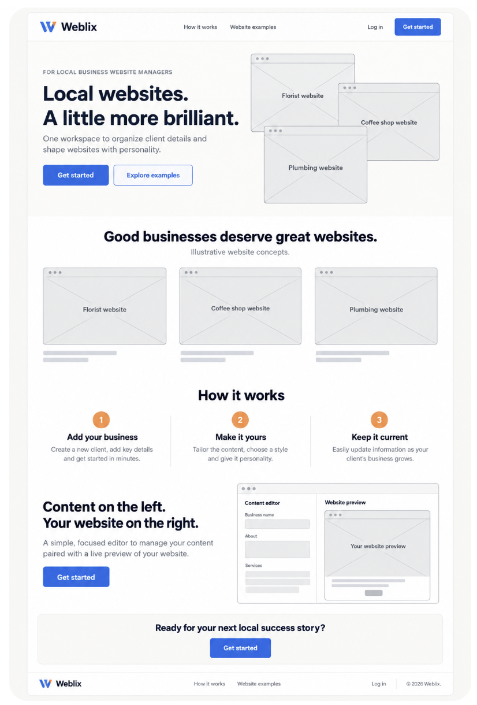
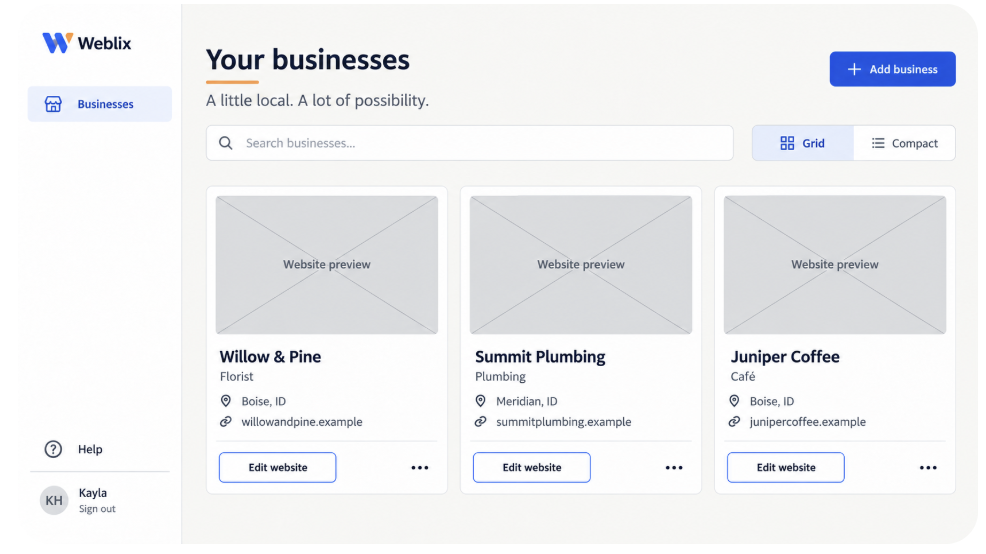
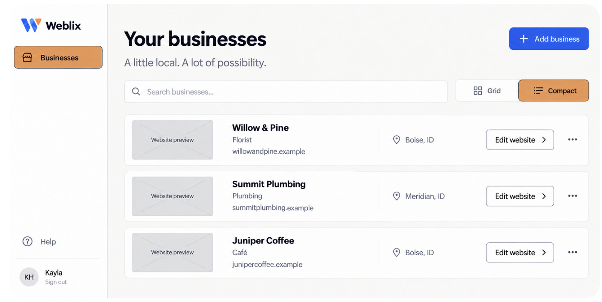
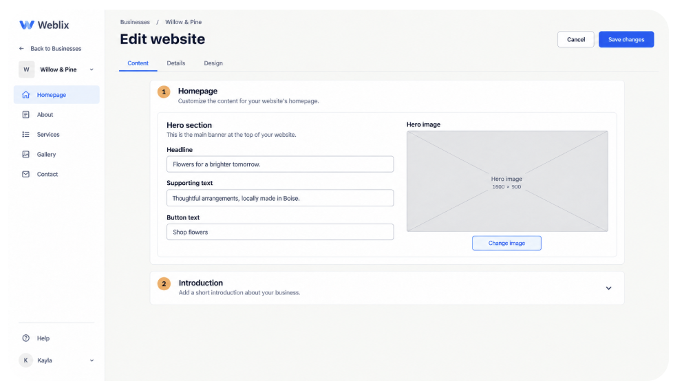

# Weblix UI Design Brief

Agreed direction · October 26, 2026

## Audience and character

Weblix is a workspace for people managing websites for local business clients, initially a single website manager. Business owners are not the intended users. The interface should feel uncluttered, professional, spacious, and quietly creative. Use bold clean headings and rounded panels. Add personality through purposeful color and client website previews, not unrelated decoration.

This brief records the design direction; it does not authorize app implementation. Wireframes illustrate proposed behavior, including features that are not built yet. Marketing copy, logo concepts, and sample client data remain provisional.

## Color system

| Role | Color | Usage |
| --- | --- | --- |
| Page background | `#F7F7F5` | Neutral grayish off-white; no blue or pink cast |
| Surface | `#FFFFFF` | Sidebar, cards, rows, forms |
| Main text | `#202734` | Headings, labels, icons, text on apricot |
| Secondary text | `#566171` | Descriptions and metadata; verify against each surface |
| Primary blue | `#3566D6` | Main actions with white text, links and focus treatment |
| Apricot | `#E99855` | Selected sidebar destination and selected Grid/Compact option; restrained numbered section markers |
| Neutral border | `#D8DCE2` | Decorative panel separation; strengthen essential control boundaries as needed |

The original apricot hex above is the specification. Generated previews appeared somewhat darker and are not authoritative color samples. Do not substitute pale peach for the selected-state fill. Use dark text/icons and a thin dark boundary on selected apricot controls. Blue means primary action; apricot means current selection in navigation and view controls.

No orange notification-like dots by business names, orange heading underline, apricot heading background panel, pastel blobs, floating leaves, plants, sparkles, or unrelated illustrations. Keep the background neutral. Client imagery belongs inside actual client previews and image fields.

## Typography, layout, and components

- Use a clean modern sans serif in the direction of Inter, with a system sans fallback. Exact font is an implementation choice to validate against the approved clean typography; avoid bubbly or squared display faces.
- Use bold page headings, semibold section headings and controls, and regular body text. Proposed baseline: 16px body, 14px supporting labels, 32–40px desktop page headings, and 24–30px mobile headings.
- Use generous whitespace and a consistent 8px spacing rhythm. Proposed desktop content padding: 32–48px; mobile: 16–20px. Keep forms comfortably readable rather than stretching fields across very wide screens.
- White cards and business rows have subtle neutral borders, restrained shadows if needed, and approximately 12–16px corner radii. Inputs and buttons use approximately 8–10px radii. Avoid heavy effects and gradients.
- Primary buttons use blue fill and white text. Secondary actions such as Edit website use white fill, dark text, and a visible outline. Avoid the blue-text-on-gray button treatment previously rejected as link-like.
- Keep persistent input labels, clear helper text, inline validation, and explicit loading/saving/error states. Group related fields in white section panels. Save changes and Cancel remain easy to find.

## Five screen layouts

### 1. Public homepage

Use top navigation, with Weblix branding, links to How it works and Website examples, Log in, and a primary entry action. Include a complete footer. Page flow: confident hero with website examples, example gallery, three-step workflow, editor explanation, final call to action, footer. Use generous whitespace and restrained apricot accents with dark labels. Describe live preview as a future concept until available; do not imply unbuilt functionality is shipped. Final copy and entry-action behavior require product validation.

### 2–3. Businesses: compact and grid

Both layouts share the same left sidebar, heading, search, Add business action, and visible Grid/Compact switch. The selected view and selected sidebar page use original apricot with dark labels/icons and a thin dark outline. Keep the heading directly on the neutral page background.

- Compact: separate horizontal white rows with a small website thumbnail, business name, industry, domain, location, Edit website action, and a secondary overflow control where meaningful actions exist.
- Grid: rounded white cards with a large website thumbnail above the same business metadata and actions.
- Use the same records and action labels in either view. Switching views must preserve search context; remember the preference for the user when implemented.
- During design review use gray rectangles with diagonal crosses and descriptive labels instead of real images. In the app, show a useful placeholder until an actual preview exists; never fabricate a client screenshot or domain.
- Provide empty, no-search-results, loading, and error states in the same visual language. These states are requirements, not yet separately approved mockups.

### 4–5. Editor: with and without live preview

Use left navigation for content sections, with client context and a route back to Businesses. Top-level tabs are **Content, Details, Design**. There is no Settings tab.

- Content: website sections such as Homepage, About, Services, Gallery, and Contact. Homepage contains editable website content such as headline, supporting text, button text, and hero image. Section names and availability should follow the actual template capabilities.
- Details: business name, industry, phone, email, website, city, and state. These fields are not part of Content and Business details is not a duplicate link in the content sidebar. A dedicated Details-tab screen has not yet been visually reviewed.
- Design: reserved for supported appearance controls; its specific contents have not been designed or approved.
- With preview: structured editor on the left, website preview on the right, with device-size controls. Keep application styling distinct from the client website's own theme. Preview is future functionality.
- Without preview: widen and center the editing panels in the available workspace. Do not leave an empty preview column, disabled device controls, or a placeholder pretending to be a live preview. An image-upload placeholder remains an ordinary field.

## Responsive behavior

These are implementation requirements to validate with mobile mockups, rather than layouts already visually approved.

- Public navigation collapses into an accessible menu on small screens; homepage sections and example cards stack naturally.
- App sidebar becomes a labeled menu/drawer on narrow screens. Keep current location and client context visible.
- Grid reduces from three columns to two and then one as space requires. Compact rows wrap metadata and actions without truncating essential names or creating page-wide horizontal scrolling.
- Search, view switch, and primary action wrap into usable rows. Keep labels and adequate touch targets.
- Editor fields stack into one column. At narrow widths, switch between editing and preview rather than squeezing both side by side. Keep save actions available without covering content.

## Accessibility requirements

- Target WCAG 2.2 AA. Verify final CSS colors and every interactive state; generated images are not contrast test evidence.
- At the specified colors, dark `#202734` text on apricot `#E99855` is approximately **6.49:1**. White on apricot is approximately **2.31:1**, so do not use white labels on apricot. White on blue `#3566D6` is approximately **5.22:1**.
- Normal text needs at least 4.5:1 contrast; large text needs 3:1. Essential graphical indicators and control boundaries that are necessary for identification need 3:1 against adjacent colors. Apricot against white is only 2.31:1: use the dark boundary and additional selected-state cues rather than an orange outline alone.
- Do not communicate selection, errors, or status by color alone. Use semantic current/selected states, clear labels, and visible shape/border or weight changes. Keep keyboard focus distinct from the persistent selected state.
- Support keyboard navigation, visible focus, semantic headings/landmarks, accessible tab behavior, correctly associated field labels/errors, announced save feedback, and logical reading order.
- Aim for 44px touch targets; provide accessible names for icon-only actions and meaningful alt text for useful images. Decorative placeholders must not add screen-reader noise.
- Support 200% text zoom and reflow at 320 CSS pixels, reduced motion, and no hover-only essential actions. Warn before discarding unsaved edits.

## Handoff boundary

The design direction is approved sufficiently for this brief. The app has not been modified. Before implementation, validate actual feature availability, Details and Design contents, responsive layouts, final copy, and component states. Preserve the agreed palette and layout rules while resolving those details.

## Confirmed first implementation scope — October 26, 2026

This section resolves mockup inconsistencies and supersedes illustrative feature suggestions above. Scope/design approval does not itself dispatch implementation.

- Implement business search and working Grid/Compact layouts now. Switching views preserves search; remember the selected view on the same browser. Use accessible pressed/selected semantics.
- Restyle existing saved website-content fields under Content and existing business fields under Details. Omit Design, unsupported content-section links, image upload, button-text fields and other unsupported controls. Do not change the content schema to match the mockup.
- Use the editor WITHOUT live preview. No empty preview column, disabled device switcher or simulated preview. Real live preview is deferred to future work; Granite renderer scope remains separately undefined.
- First landing-page pass has Log in and accurate product content, but NO Try demo button, registration/Get started flow, broken demo link or promise of live preview. Omit nonfunctional website-example links; synthetic application examples may explain what currently exists.
- A SEPARATE follow-up issue delivers an anonymous synthetic app demo and adds its working Try demo entry point. Demo browsing/details/content examples and CSV review run without persistence, shared credentials or access to private data. Clearly identify demo behavior and reset/reload behavior. No real confirmation/save in the demo.
- Approved initial logo direction: clean blue/apricot W and Weblix wordmark, recreated as a maintainable vector rather than cropped from these images. Marketing copy remains subject to factual review.
- The README opening follows the delivered product: clear purpose, actual running-app screenshot, accurate agent planning/build/independent-review explanation and verified evidence links. Add the demo link only after the demo exists. Preserve usable setup details below.
- Existing login, business CRUD, CSV confirmation/retries and content persistence must retain behavior and owner isolation. New shared UI must not introduce another backend or unrelated capabilities.
- Mobile layout and control states may be resolved within this brief; verify real CSS contrast, keyboard navigation, 320px reflow and 200% text zoom. Mockup images are not accessibility or feature-verification evidence.

## Visual references

These are user-supplied design concepts, NOT screenshots of implemented functionality. The written palette and confirmed scope take precedence over inconsistencies. Gray crossed rectangles are design placeholders; deployed UI must use intentional truthful empty-preview treatment. These files document visual requirements, not PR live-app evidence.

The separate split-screen concept supplied in design review is deferred future functionality and is intentionally not an implementation reference for this outcome.
